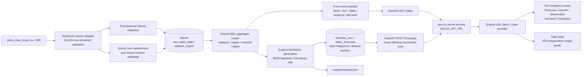

# Local Architecture

## Boundaries

The Python backend lives in `src/`, with its own virtual environment and dependency files at the repository root. The independently installed Next.js frontend lives in `frontend/`. They run as separate processes and exchange JSON over HTTP. Only Python opens SQLite; the browser cannot query the database directly.

SQLAlchemy tables in `src/db_connector.py` are authoritative. Raw sales have an internal primary key, required order/date/category/sales/quantity, nullable customer/product/dimensions, explicit currency, and date/region/channel indexes. Customer IDs absent from source remain null. Order IDs are not unique because orders can have multiple line items. `src/schema_migrations.py` explicitly copies/verifies/swaps a legacy table under a SQLite transaction and restores indexes; `create_all` alone is not used as a migration.

Ingestion maps the actual historical header, converts whole-percent discounts to fractions, and validates each chunk before insertion. It replaces rows and import metadata in one transaction; a late failure rolls back all replacement work. The prior schema migration is separately transactional and preserves legacy rows. Source data is never rewritten. There is no inferred line-item deduplication or fabricated customer identity.

`src/sales_repository.py` aggregates in SQL at overall/month/category grain without loading all transactions into Pandas. Historical reads use a consistent SQLite snapshot. `src/trend_analysis.py` operates on small aggregate frames: internal gaps become zero, comparisons use calendar offsets, and normalized seasonal profiles require complete years. Date filtering is applied after historical comparison calculations where necessary. Distinct business orders are calculated directly rather than summed across categories.

`src/forecasting.py` owns training-only ADF/AIC selection, chronological holdout evaluation and forecast intervals. `src/forecast_service.py` owns full-history cutoff selection, partial-month exclusion, fingerprinted cache, run persistence and optional atomic JSON export. The input fingerprint includes scope, cutoff, horizon, aggregate values, dataset revision and model version. Before saving, an immediate SQLite transaction verifies the data has not changed. Concurrent imports invalidate reuse without making historical GET requests fit models.

The Next.js provider owns shared category/region/channel/month filters through URL query parameters and cancels stale requests. Route children stay mounted during loading to support Next.js App Router navigation. Historical and forecast proxies whitelist parameters, return generic errors and use ten-second/120-second upstream timeouts respectively. Local services have no authentication and must not be exposed publicly.

## Next.js Replaces Power BI

React/Recharts provides five independent routes: `/`, `/growth`, `/seasonality`, `/demand`, `/forecasts`. Calculations and predictive modeling remain Python-owned. The forecast view shows monthly 95% predictive intervals, backtest errors, a seasonal-naive comparison and residual warnings. There is no DAX, Power BI date model or PBIX artifact. Seasonality is descriptive evidence; demand is realized category sales, not inventory-adjusted latent demand.

The separate `/help` guide reuses navigation and preserves filter URLs, but bypasses data fetching/loading/error gates so instructions remain available without the API. Shared currency formatters and the `Money` presentation component abbreviate large displays without altering API values or calculations; exact KPI/table amounts remain available through hover and assistive text. Currency-aware chart tooltip callbacks also format prediction interval ranges.